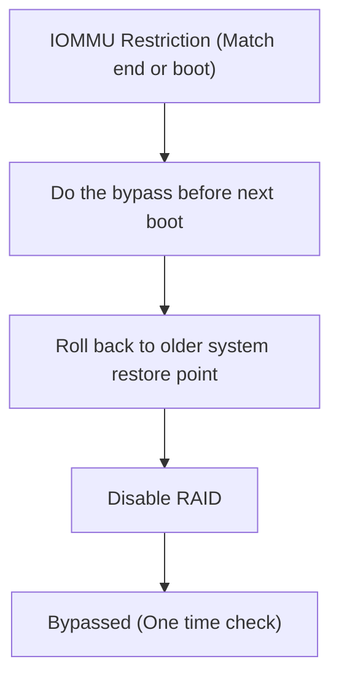

# Valorant IOMMU Restriction Bypass (Not patched)

> **Status:** Not patched, reported multiple times to Riot.  
> **Target:** Vanguard IOMMU / VT-d restriction bypass  
> **Reason:** Undestand how the bypass works and its fix.

Explains a bypass of Valorant's IOMMU / VT-d restriction without relying on VMD or firmware bypasses.

## Contents

- [IOMMU / VT-d and DMA](#iommu--vt-d-and-dma)
- [How the bypass works](#how-the-bypass-works)
- [Fix](#fix)
- [Note](#note)

---

## IOMMU / VT-d and DMA

- **Why IOMMU / VT-d matters:** Direct Memory Access (DMA) can read/write memory. Enabling IOMMU / VT-d restricts memory access so DMA cannot read game or OS memory.
- **Why bypassing it is an issue:** A DMA setup uses four parts:
  1. **Secondary PC / Laptop:** Runs the cheat software and drivers.
  2. **DMA Device:** Reads memory from the target system over PCIe/DMA.
  3. **Aim Device:** Alters mouse/input signals by overriding actual mouse inputs.
  4. **Fuser:** Combines video output from the main PC and cheat overlay PC onto the display.

When IOMMU restriction is done without a bypass, the DMA device is blocked from reading target memory.

| Aspect | IOMMU Enforced | IOMMU Bypassed |
| :--- | :--- | :--- |
| **Direct Memory Access (DMA)** | Restricted / blocked | Allowed to read target memory |
| **Enforcement Check (Restriction)** | Verified at restriction | Bypassed by reset before 1st check |
| **Detection Risk** | Restriction restriction blocks playing | Might get detected soon... |

---

## How the bypass works

The bypass relies on doing the bypass during the same boot when the IOMMU restriction appears, before a normal restart:

1. **Time frame:** Perform the steps right when the IOMMU restriction appears (at match end or on boot, before rebooting again).
2. **System Restore point:** Roll back to an earlier System Restore point created before the restriction appeared.
3. **Disable RAID:** Toggle or disable RAID configuration as part of the state reset.

## Fix

Because the anti-cheat operates at the kernel level, a proper fix is to check IOMMU/VT-d consistently every boot.
## Note

Published to show how riot's anti-cheat can be improved. This bypass is probably going to get detected soon...
